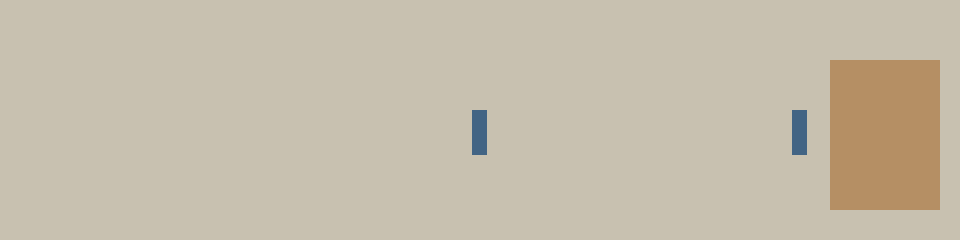

# 电商修图流 · EcomRetouchFlow

以 **ygl-trees CLI 为底层的电商领域高级封装**。现有 Agent 理解需求，`retouch` 编排原生项目、任务、产物、关系、知识与索引能力，并处理素材、上下文、检查与交付。

> 当前迁移状态：0.2.0 技术基线仍含独立 SQLite 业务账本，与用户最新明确的高级封装边界有偏差。后续必须收敛到 ygl 原生事实与索引，不能继续扩展独立引擎；迁移和复验路线见 [原生封装规范](docs/YGL-WRAPPER-MIGRATION.md)。新路线尚未完成，不把历史 42 项通过等同于架构符合。

用户路径：提供原图和需求 → 审阅修改区域、顺序和费用 → 授权计划 → 分步处理与检查 → 查看实际对照图并验收 → 交付。

## 当前进度

**0.2.0 实现业务项目与目标版本、统一产物与来源关系、外部执行回接，以及完整项目 ZIP 导出／预检／导入。** 保留 0.1.0 的离线两步工作流和宿主图像任务回接协议。图像执行默认 host；独立图像 API 为显式 fallback，适配器尚未接入。

已实现任务与需求组、冻结计划、独立 ygl 图与证据、请求去重、步骤租约、实际图片处理、宿主任务单、局部合成、检查、终验与可恢复交付。实际测试与复现命令见 [验证说明](docs/verification/README.md)。

- [Agent 业务操作技能](SKILL.md)
- [CLI 使用与 JSON 契约](docs/CLI.md)
- [项目管理、接手与 ZIP 跨工作区往返](docs/PROJECT-CONTEXT.md)
- [宿主图像执行与回接](docs/HOST-EXECUTOR.md)
- [当前路线图与实现边界](docs/ROADMAP.md)
- [实现与验证说明](docs/IMPLEMENTATION.md)
- [当前实现架构](docs/ARCHITECTURE.md)
- [动态上下文工程路线提案](docs/DYNAMIC-CONTEXT.md)
- [ygl 高级封装与历史实现迁移](docs/YGL-WRAPPER-MIGRATION.md)
- [本地归档与公开范围](docs/ARCHIVE.md)

## 工作流原则

- 需求有文字且未停用就参与；保留用户原文、独立分组补充和保持项。
- 每一步绑定明确的工作图、区域、参考用途和检查条件；后一步承接前一步通过检查的真实结果。
- 请求提交、收到图片、质量检查、人工接受和交付分别记录。
- 修正保留旧版本；未知请求先对账，避免重复提交与重复费用。
- 任务必须绑定项目、目标版本与完成条件；设计文档完成、图片生成、用户接受和交付分别判断。
- ZIP 保留完整素材与来源；重复导入幂等，恢复不自动执行图像工具或继承源机器权限。

首个实现目标是单商品图的两步流程，例如“改把手 → 检查 → 换门板材质 → 检查 → 人工验收”。先交付离线可运行闭环，再验证一个真实图像提供商。

## 快速验证

需要 Node 24.12+（24.x）与已安装的 ygl-trees 0.125.0。所有命令在本项目根执行。

```text
npm ci
node src/cli.ts --help
npm run typecheck
node scripts/test.mjs --unit-only
node scripts/demo.mjs --ygl-entry <已安装的-ygl/dist/bundle/bin.cjs>
node scripts/test.mjs --ygl-entry <已安装的-ygl/dist/bundle/bin.cjs>
```

演示会创建独立工作区，实际处理两张本地图像并通过真实 ygl CLI 记录证据，再交付 PNG 和 manifest。它使用确定性的离线处理，无 AI 出图或独立 API 费用；演示验收来源明确标为 demo。



命令行入口为 `node src/cli.ts`，`--help` 查看实际命令；`--json` 的 stdout 为单一 JSON 信封。Windows PowerShell 推荐直接调用上述 Node 脚本，避免 npm.ps1 吞掉转发参数。仅运行本地契约测试可显式使用 `node scripts/test.mjs --unit-only`，报告会标注原生集成 NOT_RUN。

## 用宿主处理真实任务

向具备图像编辑工具的 Agent 提供原图与需求，让它读取本项目说明和宿主协议。Agent 通过 CLI 整理计划、取得实际用户确认，再将任务单交给宿主内置图像工具；生成文件回接后进行局部合成和实际看图检查，最终由用户验收。

当前会话未暴露 `image_gen`，内置图像生成端到端验证为 NOT_RUN。首版区域为固定画布整数矩形，硬检查保证保持区像素一致；语义效果依赖实际看图与用户终验。同一 OS 身份可写文件时，确认回执不构成恶意 Agent 安全沙箱。

原始探索文档仍保留拟议的更广接口；**当前可运行命令以 CLI help 和 [CLI v1](docs/CLI.md) 为准**。宿主优先的决策见 [ADR-002](docs/ADR-002-host-first.md)。

## 开源范围

采用 [MIT License](LICENSE)。`archive/`、运行现场与本机研究／验证记录由 Git 忽略，保留在本地。公开仓库的源码、技能和测试可独立使用，不依赖原浏览器插件。
