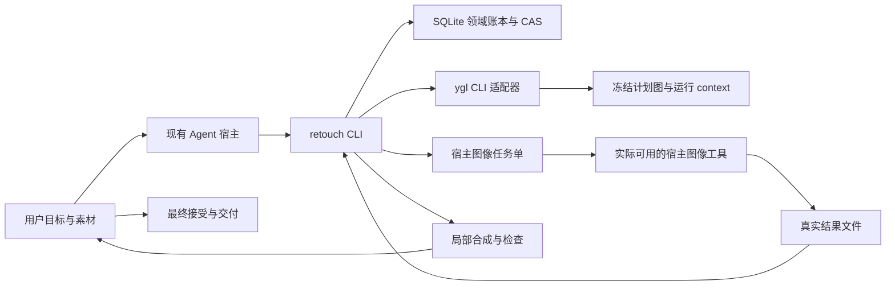

# 实现现状与架构迁移 · 0.2.0

用户最新裁决：产品是 ygl-trees CLI 的高级封装。下图与后文记录 0.2.0 历史现状，其中独立账本为权威、ygl 为投影的分工需要迁移。目标是由 ygl 原生 project/task/produce/rel/research/kb、节点和索引承载事实，retouch 只做领域编排与素材／上下文适配；禁止另建独立业务库或全局索引引擎。证据、缺口和步骤见 [迁移规范](YGL-WRAPPER-MIGRATION.md) 与 [ADR-004](ADR-004-dynamic-context.md)。

## 状态归属

SQLite 账本保存任务、需求、冻结计划、授权、运行、尝试、事件、请求去重和 outbox。原图、规范化工作图、蒙版与候选字节存入不可变内容寻址对象库。模型文字、临时 URL 和 ygl unlock 不能替代实际图像。

业务 Project 与版本化 Goal 先于任务执行。Design、Artifact、Execution、Review、Provenance 和 Relation 也在同一账本中；图像与文档进入同一 CAS。外部生成和后处理可以补登记为事实，不能冒充正式 run 或用户接受。SQLite 索引由事务维护，project brief 从当前记录生成；ygl 项目投影带源指纹，落后时显示 pending。

ygl 接收计划结构及已提交领域事实的证据投影，计算依赖。每个冻结计划有独立树，每次运行有独立 context；执行前同时验证领域事实、投影身份和门结果。补同步只修复记录，不重新调用图像工具。

ZIP 导出取一致性领域快照并包含全部必要对象；导入验证版本、清单、真实尺寸和图关系后事务恢复，再用本机绑定重建投影，不复制数据库或源配置。历史授权在目标工作区标为来源事实，原交付路径不激活，unknown 不改变。格式、恢复协议与取舍见 [项目上下文](PROJECT-CONTEXT.md) 和 [ADR-003](ADR-003-project-context-zip.md)。

## 执行边界

host 为默认执行器：CLI 生成任务单，Agent 核实工具可用后先记录一次执行意图，再调用宿主工具，最后回接真实文件。CLI 只合成批准矩形内的结果，保留原始输出，检查实际候选后才进入下一步。用户终验与 Agent 检查分别记录。

offline 仅在 demo 工作区使用，用于可重复验证图像承接和恢复。独立 API fallback 尚未实现，也不会自动读取密钥。当前只支持固定画布、整数矩形与连续串行图像链。

## 文件入口

| 位置 | 职责 |
|---|---|
| `src/cli.ts` | 参数、JSON 信封、退出码和命令路由 |
| `src/domain/` | 对象、需求与计划校验 |
| `src/application/service.ts` | 事务边界、运行、授权、恢复与交付 |
| `src/application/projects.ts` | 项目、目标、设计、产物、外部事实、关联和实时摘要 |
| `src/application/context-exchange.ts` | 一致性快照、ZIP 契约、预检、幂等恢复、身份映射与索引重建 |
| `src/infrastructure/store.ts` | SQLite、CAS、事件与 outbox |
| `src/infrastructure/zip.ts` | 有边界的 ZIP 读写、路径及解压限制 |
| `src/adapters/images.ts` | 规范化、蒙版、合成与图像检查 |
| `src/adapters/ygl.ts` | 版本身份、独立 home、冻结图与证据同步 |

业务操作见 [SKILL.md](../SKILL.md)，协议见 [CLI v1](CLI.md) 与 [宿主执行](HOST-EXECUTOR.md)。初始探索、迁移清单及原插件归档属于本地历史材料，不是公共运行依赖。
