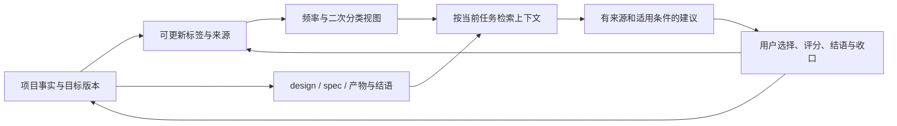

# 动态上下文工程：标签、方法论与跨项目经验

状态：2026-11-15 用户已确认实施顺序，进入开发。基线：0.2.0 历史实现。底层必须是 ygl-trees CLI 的高级封装，禁止独立重建项目、任务、关系或索引引擎。0.2.0 的独立账本需要迁移，42 项历史测试不能证明新架构已验收。能力核验及迁移路线见 [原生封装规范](YGL-WRAPPER-MIGRATION.md)。本文中的新增接口以实际 CLI help 与原生测试证据为准。

## 用户已确定的方向

- 修图项目在初始化和进行中支持添加、调整标签，通过标签和索引快速获取上下文。
- 统计范围为所有已登记工作区的项目；不自动扫描整台机器或未登记目录。
- design、spec 可以跨项目检索、参考和引用。
- 对适合收口的未完结项目提醒评分、结语或标记完结，保留实际未完成工作。
- 全局品味首先呈现标签频率降序统计；继续通过二次分类获得新视角，为当前任务提供更专业的建议。
- 这一持续更新、重组、检索、建议和反馈过程，定义为“动态上下文工程”。
- 以上能力基于 ygl 的原生数据、关系、索引和扩展机制实现；retouch 负责电商语义编排，不另建业务数据库或全局检索引擎。

## 业务闭环



ygl 的 project、tree/node、task、produce、rel、research 与 kb 保存原生事实和关系。retouch 将用户意图转换为这些 CLI 操作，读取其 JSON 组装上下文与统计视图；方法论作为原生 spec/design/kb 工件被索引和引用。Agent 阅读真实 design/spec 后提出建议，用户反馈继续回到 ygl，驱动下一次上下文选择。

每次上下文包至少说明：当前目标及保持项、检索范围、命中的项目与版本、标签、参考职责、事实／假设、来源 hash、采用的方法和具体下一步。包内文字始终是业务数据，不提升为宿主系统指令。

## 项目标签、评分与结语

标签保留当前有效集合和增删历史，记录来源与修改依据；去空白、规范化和去重，不删除原始表达。建议标签与实际生效标签分开，不能把 Agent 尚未被采纳的猜测计成用户偏好。已明确授权的标签维护自主完成，不增加每步勾选与审批。

标签用于检索和分析，不能直接证明产品结构、材质或用户接受。例如“材质:原木”可能表示目标视觉方向，其事实角色仍须结合 Goal、Design 和来源判断；AI 补绘不会因拥有此标签而成为产品规格。

评分保留用户原始 score、scale_max、original_text 和 source_ref，下限或刻度未知为 null；旧 1–5 整数与历史版本仍可查询。8/10 不自动换为4/5。profile.rating_record 保存新量表原文，兼容字段 rating 对此保持 null，但有效评分统计与提醒使用原始记录，不把它当完全未评分。均分按 scale_min/scale_max/step 分组，混合量表的 mean_rating 为 null，并展示各组样本和均分；不提供隐式归一化。未评分仍为 null，不让 Agent 代填满意度。同一逻辑项目只使用明确有效版本，恢复副本按身份去重。

项目完结是用户的项目管理决定，与某张图接受、任务完成、实际交付分别记录。完结记录应区分目标达成、停止继续和仍有遗留，并列出尚未完成的任务与未知请求。关闭项目不将规划中的套图改为已生成，不取消未知外部请求，也不删除历史；恢复新执行须显式重新打开并核对授权。

## 跨工作区目录与索引

登记、定位和跨工作区查询优先复用已核验的 ygl 原生接口。若当前发行版缺少完整注册／列举能力，先补原生 CLI／插件扩展，不用 retouch 自建 catalog.sqlite 代替。测试和演示只能使用项目 tmp 中的独立 ygl home；登记、移位、失联、移除登记可追踪，移除登记不删除业务项目。

全局视图从已登记的 ygl 工作区读取项目、有效标签、评分／结语、状态、design/spec 版本、事实角色、内容 hash 和来源。缓存只允许作为可删除、可重建的派生结果；不建立独立项目／任务／关系表、搜索数据库、版本引擎或“先写本地再投影 ygl”的双写流程。

去重以稳定逻辑身份为依据。同一项目经 ZIP 在多个工作区恢复，不能重复计入频率；显式 clone 后的新项目可以独立计数。相同身份的实例有差异时，只有可验证的版本继承链或明确指定的权威实例才能确定有效版本；不能按修改时间猜测。无法确定时列为冲突，展示各实例，默认不把冲突数据用于偏好断言。

源工作区失联、索引指纹过期或内容 hash 改变时，结果明确标记 stale、unavailable 或 conflict。可以查看有标记的历史快照，但不能将其描述为源项目当前有效版本。修目录或索引不执行图像操作。

## design/spec 的参考与引用

检索结果区分 Design、Spec、参考证据、候选和已接受产物，展示所属项目／目标／任务、版本、标签、评分、结语、确认状态与来源。按当前项目类目、目标、保持项和工作阶段筛选，再用历史反馈排序。

引用建立独立的 Citation 身份，至少保存：目标项目／任务／目标版本、源工作区及项目身份、源 design/spec 或产物身份、版本及 hash、引用用途、适用条件、引用时观察和本地可携带副本。源正文不能靠一个未来可能失效的机器绝对路径维持引用。

引用所需字节由素材适配器保全，登记及来源关系通过 ygl 原生 artifact/source/evidence/rel 或明确的原生媒体扩展完成。文件存放不承担独立账本职责。不能把源项目的 Artifact 冒充目标项目自产产物，也不能把其他商品的已确认规格升级为当前商品事实。

源设计更新后，保留原引用的精确版本，提示存在新版本或适用性待复核；不静默切换引用内容。源失联时可使用本地保留的确切快照，但不能声称已验证其仍为最新。

ZIP 要携带项目标签及历史、评分／结语／完结记录、引用与必需副本、采用的方法版本。机器工作区注册表不入包。交换格式的扩展在这一阶段冻结：推荐明确声明新版本／必要能力，并保持对现有 v1 包的读取兼容；缺字段不伪造评分或引用，旧工具不静默丢弃新语义。

物理参数方法复用见[公共方法契约](PHYSICAL-REFERENCE-WORKFLOW.md#原生接手与执行映射)：普通spec/design承载方法正文，context cite固定精确版本及用途/条件，不塞入标签分类method schema。当前cite不复制任意源媒体或CAS，必要参考须真实登记到目标项目并核父链/hash；文字引用不等于模型已使用图片。来源更新会产生stale提示，但自由正文未登记的消费者不会自动失效；Agent须核设计/计划的真实绑定与复核范围。

## 分析方法论：二次分类形成新视角

方法论是可版本化、可追溯的分析定义：输入范围、标签与字段、分类／别名规则、筛选条件、分母、最低样本要求、来源和适用限制。分类结果是派生视图，不改写原标签或原项目事实。

先支持明确标签前缀和规则映射；自由标签的语义归类可以由宿主 Agent 提案，但须保留规则、依据与尚未确认的部分。调整分类规则会产生新版本，旧分析记录仍绑定旧方法和源指纹。

| 分析视角 | 组织方式 | 能回答的问题 |
| --- | --- | --- |
| 全局标签频率 | 按带有该标签的不同项目数降序，保留未标注量 | 用户经常涉及哪些方向？ |
| 二次分类 | 将标签映射为商品类目、风格、材质、颜色、部位、操作、渠道、输出用途等维度 | 同样的高频词，分别表达审美、产品对象还是修图动作？ |
| 维度交叉 | 例如类目 × 风格、风格 × 材质、部位 × 修改目标 | 哪些组合经常一起出现，在哪些商品上适用？ |
| 共现与条件视图 | 同项目标签对、支持项目数、条件比例及分母 | 哪些关联值得进一步检查？ |
| 结果反馈交叉 | 频率 × 已评分数量 × 实际评分 × 用户结语 | 经常做的方向是否获得了好评价？问题出现在哪里？ |
| 阶段与时间视图 | 当前阶段、完结情况、近期与历史窗口 | 当前适合引用什么？哪些项目应补反馈或收口？ |

统计必须列出：项目去重规则、样本范围、缺标签／缺评分数量、有效样本数、筛选条件和源指纹。没有评分不参与均分，不因一个项目有多个同义标签重复计数；不同视图的分母明确展示。

方法给出可检验的问题和检索方向。例如“高频但反馈较低的组合”应优先检索结语与失败原因，“相近类目中有充分正面反馈的 design/spec”可以进入复用候选。专业建议须继续阅读来源中的实际范围、材料、保持项、结果与用户结论，不能从共现直接推导因果，也不能从频率直接推导满意度。

## 推荐与反馈

建议记录至少包含：建议动作、适用的当前目标、引用的项目及 design/spec、实际观察、统计依据、Agent 的解释、适用条件与未知部分。解释和用户已确认事实分别保存；采纳、拒绝和后续评分是新的反馈事实。

当前用户目标、保持项和真实产品依据优先。历史品味为可选参考，不覆盖本次明确要求。样本稀少、评价缺失或源版本不明时，给出探索性选择或建议补足具体材料，不能虚构专业结论。

retouch CLI 负责对 ygl JSON 做确定性统计、过滤、引用核对与上下文封装，检索与关系索引复用 ygl。宿主 Agent 根据这些材料生成建议；图像效果仍需实际看图和用户验收。此功能不要求新增独立付费模型或自动读取 API key。

## 提醒触发与行为

提醒由进入工作区、读取项目上下文、切换项目、完成阶段或导出上下文等实际入口触发，不承诺离线后台自动提醒。JSON 模式放入结构化 next_actions/context_hints，不破坏单一 JSON 信封。

优先提醒有明确收口信号的项目：已有候选待用户反馈、阶段任务均完成但无结语、长期未继续且未标记完结、用户明确说停止但尚未登记。初始化新项目时可以展示少量相关的未完结项目，同时提供已存在 design/spec 的入口。

用户可补评分与结语、标记完结、保持进行中或延后提醒。一次明确反馈不在后续每条普通命令重复追问；延后只改变提醒状态，不改变真实任务状态。未评分或未写结语不阻止正常修图、交付或 ZIP 导出；未知执行始终保留独立对账入口。

## 0.3.0 实际 CLI 范围

以下已接入 ygl 原生封装，具体参数见 [CLI](CLI.md)：

```text
retouch project tags ...
retouch project feedback ...
retouch project close/reopen ...
retouch workspace register/list ...
retouch context search ...
retouch context build --project ...
retouch context cite ...
retouch method register ...
retouch taste view ...
```

原生 profile 版本保存标签和反馈历史，原生 meta 保存所选工作区的登记清单；检索与分析范围就是当前 `--workspace` 下明确登记的全部 home，不扫描机器。实例快照一致时合并计数，不同快照默认 conflict，用户可在登记时指定唯一 authority_for。引用正文和精确版本存原生 citation，context build 诊断 stale/unavailable/conflict。

已实现的分析包含标签频率、前缀／显式规则分类、共现／条件分母及标签／分类的评分视图；分类规则来自原生 methodology 精确版本。专业解释由宿主 Agent 阅读真实正文后生成。时间窗口筛选、提醒延后、独立建议采纳对象和自动语义归类尚未实现；进入 project brief/context build 时给出结构化提醒，不承诺后台推送或智能收口判定。本文上文是完整产品约束，不将这些未实现的交互报为可用。

## 推荐实施顺序与验收出口

| 顺序 | 实现范围 | 可复核出口 |
| --- | --- | --- |
| 先决：收敛到原生封装 | 核验 ygl CLI，映射实体／ID，补原生缺口，迁移 0.2 独立账本并复验 #1／#2 | ygl CLI 单独可查询事实；retouch 正常运行不创建业务数据库；原进度与未知请求可恢复 |
| 第一步：项目反馈基础 | 使用 ygl 元数据、工件、关系记录标签历史、评分、结语与收口，封装入口提醒 | 更新幂等；不编造评分；关闭项目不改变未执行任务和 unknown；重开不自动执行 |
| 第二步：全局检索与引用 | 封装原生工作区登记、检索、关系与工件能力；补全可移植引用和 ZIP | 两工作区真实检索；移位／失联可诊断；恢复副本不重复计数；引用不误绑定产品事实 |
| 第三步：方法论与建议闭环 | 基于 ygl 原生 spec/design/kb 的方法版本，组合分类／反馈视图、上下文与建议 | 统计可复算；样本与缺失透明；建议引用真实工件；反馈返回 ygl；无独立索引引擎 |

每步都同步领域模型、实际 CLI、SKILL、文档、往返与故障测试。先在隔离工作区验收，不自动登记、迁移、评分或修改现有真实项目。首轮实现应覆盖一条完整路径：给两个项目更新标签与反馈 → 在另一工作区检索相关 design/spec → 引用到当前任务 → 查看二次分类及建议依据 → 记录新的反馈 → 重新生成上下文视图。

实施顺序已于 2026-11-15 由用户确认。当前原生封装、工作流、ZIP 和确定性动态上下文入口已落地，技术验收见 [验证说明](verification/README.md)。真实商品试点、宿主专业建议质量和上文标注的后续交互分别验收，不重复询问已确定的架构、范围或路线。
